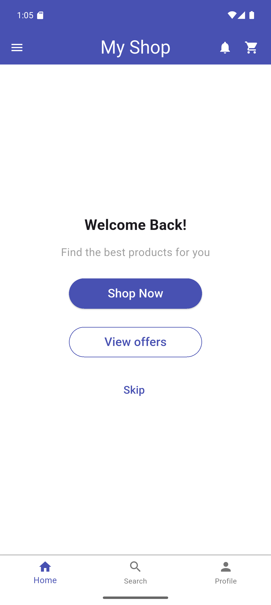
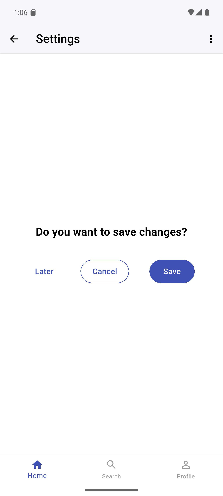
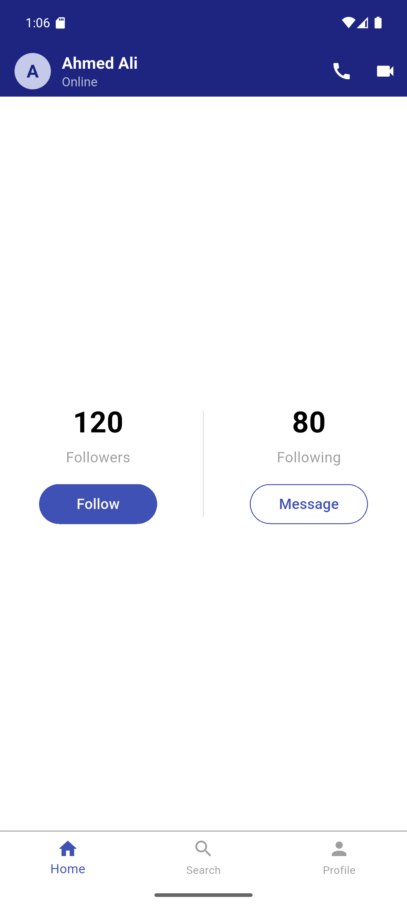

# 🛒 Flutter Task 01 - Shopping App UI Demo

A comprehensive and clean UI demonstration built with Flutter. This project serves as a frontend template for a shopping application, focusing on responsive layouts, Material Design principles, and seamless screen navigation.

---

## 📱 Screens Overview

The application consists of three main screens, each demonstrating different Flutter widgets, layouts, and styling techniques:

### 1. Home Screen (Welcome)

The entry point of the application, designed to greet the user and provide quick access to core features.

* **Navigation Actions:**
  * **Shop Now:** Routes the user to the **Settings Screen**.
  * **View Offers:** Routes the user directly to the **Profile Screen**.
* **Design Focus:** Simple layout prioritizing user call-to-actions (CTAs).



### 2. Settings Screen (Action Prompt)

Opened by tapping the **Shop Now** button. This screen demonstrates a clean confirmation interface.

* **Custom AppBar:** Features a back navigation icon, a centered "Settings" title, and a trailing 'more options' icon.
* **Confirmation Section:** A vertically centered textual prompt asking *"Do you want to save changes?"*.
* **Action Buttons:** Displays three distinct button styles side-by-side to showcase Flutter's Material buttons:
  * **Later:** A standard `TextButton` for secondary, less emphasized actions.
  * **Cancel:** An `OutlinedButton` with custom border styling.
  * **Save:** A solid `ElevatedButton` acting as the primary CTA.
* **Bottom Navigation:** A persistent `BottomNavigationBar` (currently a UI placeholder).



### 3. Profile Screen (User Dashboard)

Opened by tapping the **View offers** button. A detailed user profile view displaying account statistics and direct interaction options.

* **Interactive Header (AppBar):** A customized app bar featuring a user avatar ('A'), the user's name ("Ahmed Ali"), an "Online" status indicator, and quick action icons for voice and video calls.
* **Statistics Section:** Uses an `IntrinsicHeight` row with a `VerticalDivider` to elegantly separate user stats:
  * **Followers:** Displays "120" with a primary **Follow** (`ElevatedButton`).
  * **Following:** Displays "80" with a secondary **Message** (`OutlinedButton`).
* **Bottom Navigation:** Consistent with the app's theme, visually indicating that the "Profile" tab is currently active.



---

## 🛠️ Tech Stack & Features

* **Framework:** Flutter (Dart)
* **Design System:** Material Design 3
* **Widgets Used:** `Scaffold`, `AppBar`, `BottomNavigationBar`, `IntrinsicHeight`, `Row`, `Column`, `ElevatedButton`, `OutlinedButton`, `TextButton`, `CircleAvatar`.
* **State Management:** `StatefulWidget` for managing the Bottom Navigation Bar active state.

---

## 🚀 How to Run the App

1. Ensure you have the [Flutter SDK](https://docs.flutter.dev/get-started/install) installed on your machine.
2. Clone this repository to your local machine.
3. Open a terminal in the project root directory and run the following commands:

```bash
# Get project dependencies
flutter pub get

# Run the application on your connected device or emulator
flutter run
```